<div align="center">


<br>

### A free code editor for Windows with AI agents built in

Ask for a change in plain words. Claude Code, Codex, Antigravity or a local model makes it,<br>
and you see every file it reads, every edit and every command while it works.

[**Download for Windows**](https://github.com/itsphatto/BreezeCode/releases/latest) &nbsp;·&nbsp; [Website](https://breezecode.itsphatto.site) &nbsp;·&nbsp; [FAQ](https://breezecode.itsphatto.site/FAQ.html) &nbsp;·&nbsp; [Report a bug](https://github.com/itsphatto/BreezeCode/issues)

<br>


<br>


<sub>[Agents](#agents) · [Several agents at once](#several-agents-in-one-prompt) · [The editor](#the-editor) · [Git](#git-and-pull-requests) · [Breeze Space](#breeze-space) · [Settings](#settings-and-usage) · [Everything else](#everything-else) · [Getting started](#getting-started) · [Project layout](#project-layout) · [License](#license)</sub>

<br>

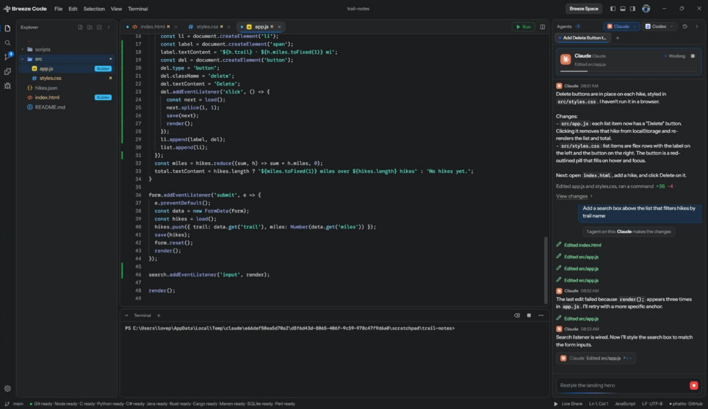

<sub>Claude adding a search box to a small project. The files it's editing are tagged in the explorer, and each step shows in the chat.</sub>

</div>

<br>

## What it is

- **An editor first.** Tabs, split editors, a terminal, Git, a debugger, live preview and language servers. All of it works with no agent connected.
- **Agents you already have.** Breeze finds Claude Code, Codex and Antigravity on your PC and uses their own sign-in. Or point it at a local model.
- **Free.** No plans or credits. You only pay for an agent if you pick a paid one, and a local model needs no internet at all.
- **Local.** Your files stay on your PC. API keys and sign-in tokens are encrypted with the Windows keychain. Updates ask before they download.

## Agents

| Agent | How Breeze talks to it | Usage shown in Settings |
| --- | --- | --- |
|  **Claude Code** | The `claude` CLI | Tokens this month, plus the 5-hour, weekly and weekly Fable limits |
|  **Codex** | The `codex` CLI | Tokens this month, plus its plan window |
|  **Antigravity** | Antigravity's agent service | Antigravity doesn't report usage |
|  **Local model** | Ollama, LM Studio or any OpenAI-compatible server | None, it runs on your PC |

Each prompt runs in one of three modes:

- **Ask** answers questions and doesn't change files.
- **Build** makes the changes.
- **Plan** writes a numbered plan first. You approve it or ask for changes, then it gets built.

Every read, edit and command shows up in the agents panel as it happens. Pick each agent's model and effort from its chip. By default agents stay inside the project and keep out of `.env` and `.git`; Settings → Agents has a **Full access** switch if you want to lift that.

Past chats are saved per project. **New chat** files the current one away and the clock button brings it back.

## Several agents in one prompt

@mention agents from different companies in one prompt and each takes a part of the job. Before they start, each one claims the files it will touch. If two claim the same file, you choose who gets it. Then they work at the same time, and every line in the chat says which agent wrote it. If an agent edits a file it didn't claim, Breeze undoes that edit and tells you.

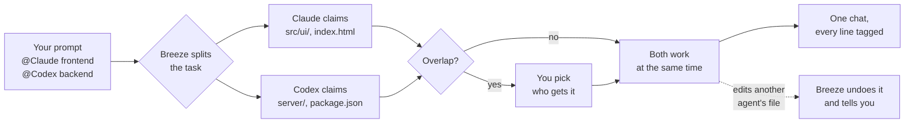

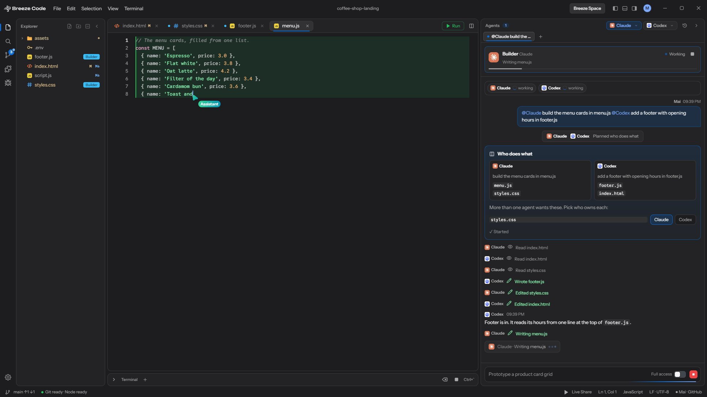

## The editor

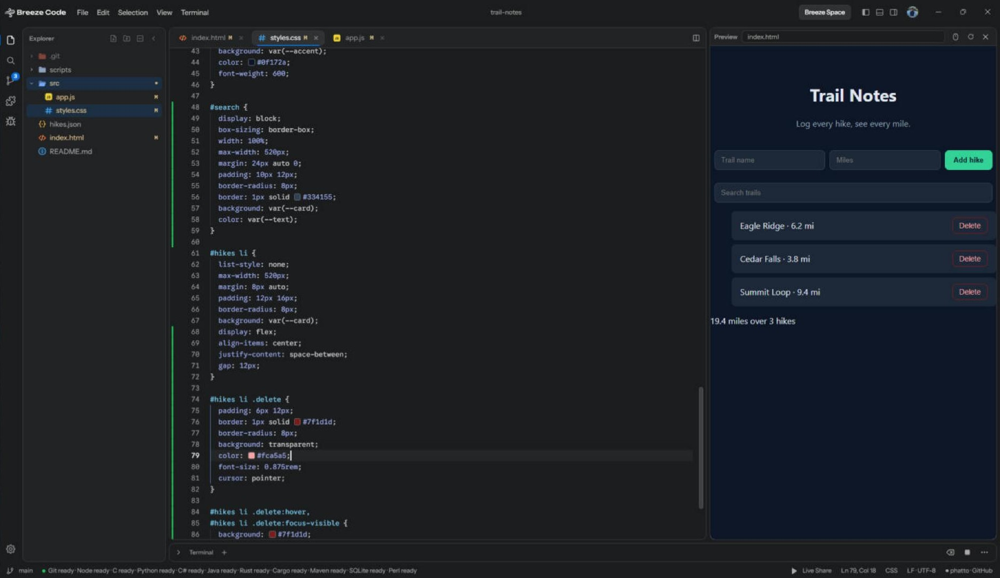

<sub>A stylesheet with colour swatches, and the page it styles in the live preview.</sub>

- **Tabs and splits.** Drag tabs to reorder them or drop one to the side to split the editor. Minimap, auto save, go to file or line, find and replace.
- **Huge files.** Text files open and save through a small Rust engine that runs next to the app. Only the lines on screen are drawn, so files up to 2 GB open and edit without loading the whole thing into the editor.
- **Language servers.** Completions, hover, go to definition, find references, rename, and errors underlined as you type. JavaScript and TypeScript work out of the box. Python, Rust, Go and C/C++ use pyright, rust-analyzer, gopls or clangd if you have them installed.
- **Colour swatches.** Every hex colour gets a small box of that colour. Click it to open a picker; each change is one undo step.
- **Multi-cursor.** Alt+Click adds a cursor. Ctrl+D picks the next match, Ctrl+Shift+L picks all of them, Shift+Alt+drag selects a column.
- **Emmet.** Type `ul>li*3` in HTML, JSX or CSS and press Tab.
- **Live preview.** Open `index.html` beside your code and it refreshes as you type. Right-click an element to see its tag, id and classes. Markdown files preview as formatted pages.
- **Command Palette.** Ctrl+Shift+P or F1, then type a few letters of any command. The ones you used last come first.

### Run and debug

- **Run with F5.** Python, C, C++, C#, Java and Rust run on the compilers already on your PC (Cargo projects too). If one is missing, Breeze tells you what to install. JavaScript runs on Node in the terminal.
- **Debugger.** Step through Python, JavaScript, TypeScript, C, C++, C#, Rust and Java. Click a line number (or press F9) to set a breakpoint, then watch variables, the call stack and your program's output.
- **Notebooks.** `.ipynb` files open as cells you can edit and run in Python. Text, tables, images and matplotlib plots show as outputs.

<details>
<summary>What each debugger needs</summary>

| Language | Needs |
| --- | --- |
| Python | `debugpy` (Breeze offers to install it) |
| JavaScript, TypeScript | Node. TypeScript needs Node 22.18 or newer |
| C, C++, Rust | GCC and GDB 14 or newer (MinGW-w64 from MSYS2 or WinLibs) |
| C# | The .NET SDK. Breeze downloads the netcoredbg debugger when you ask |
| Java | A JDK. Watches read variables and fields but don't evaluate other expressions |

</details>

<table>
<tr>
<td width="50%">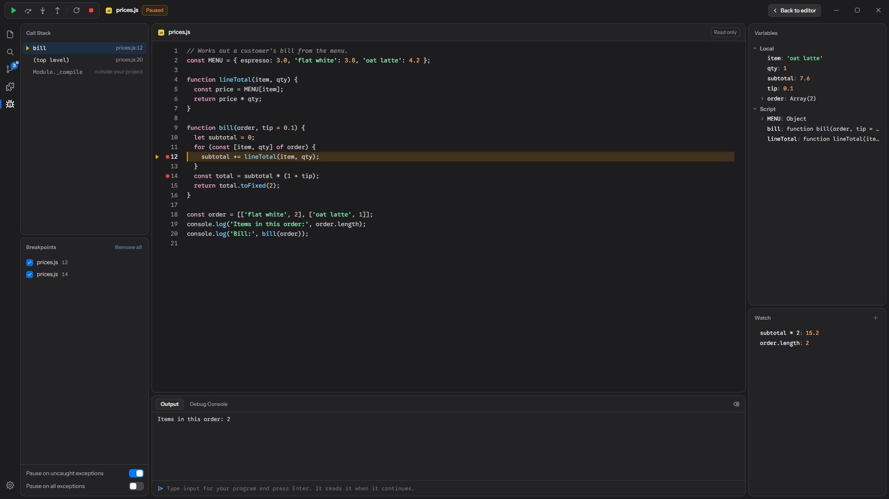<br><sub>The debugger stopped at a breakpoint</sub></td>
<td width="50%">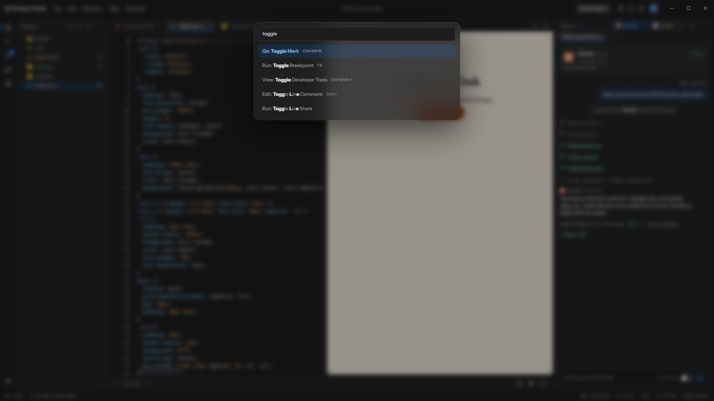<br><sub>The Command Palette</sub></td>
</tr>
</table>

## Git and pull requests

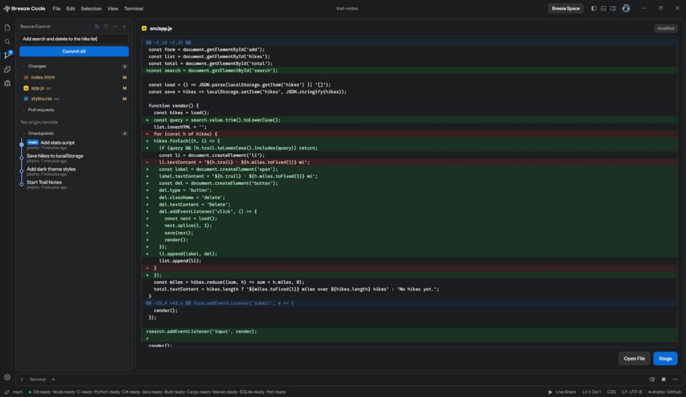

- Stage, discard, commit and push from Source Control. Commits are listed as checkpoints, with the branch graph.
- Click a changed file to see its diff.
- Files an agent is editing are marked in the explorer and on their tabs.
- **Pull requests.** Read, comment on, merge or close GitHub pull requests without leaving Breeze.
- **Merge conflicts** are resolved in a separate worktree, so your own checkout is never touched. **Conflict Duel** has one agent argue for each side, then a third proposes a merged version you can accept, edit or reject.

## Breeze Space

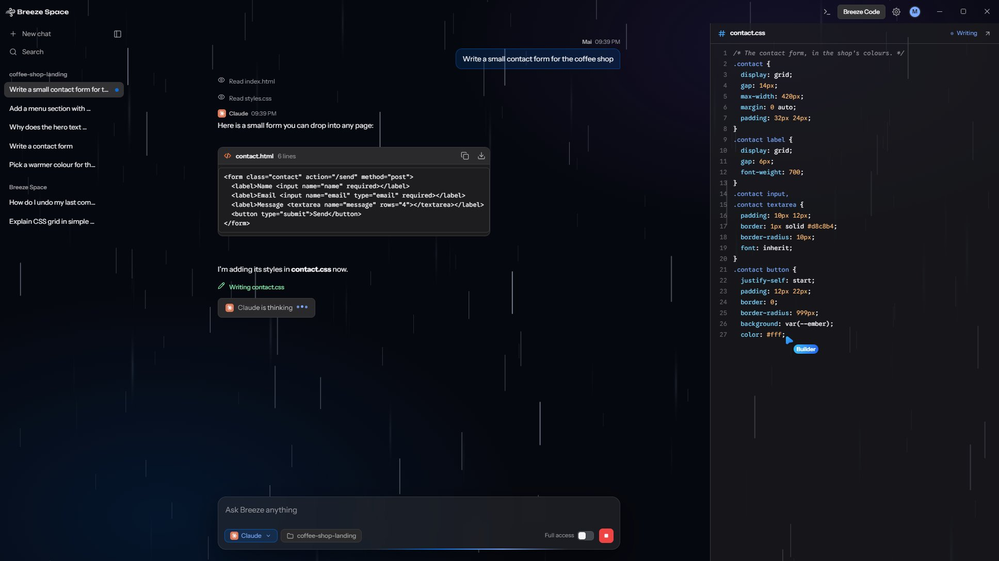

A chat-only view with no editor. Code in a reply becomes a card you can copy or save in one click. You can open a terminal beside the chat, and chats are grouped by the folder they started in. Switch between Breeze Space and the editor with the button at the top right.

<table>
<tr>
<td width="50%">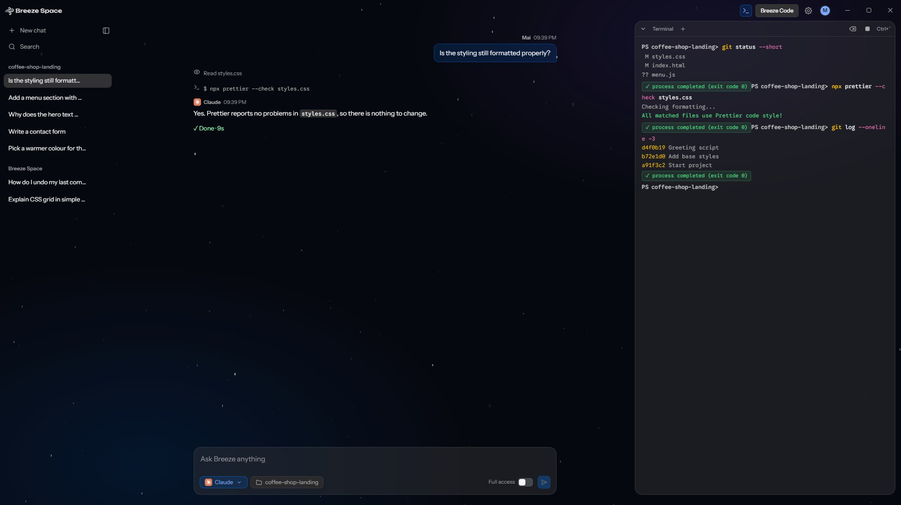<br><sub>A terminal beside the chat</sub></td>
<td width="50%">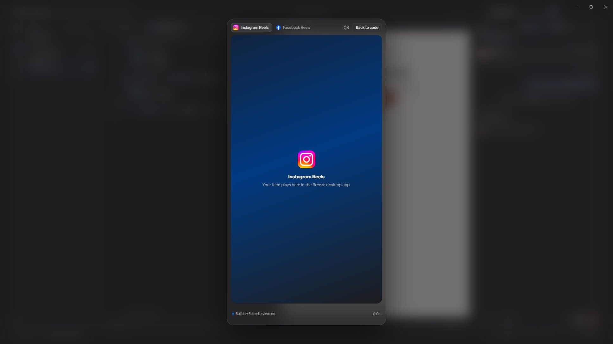<br><sub>Vibe Code Mode</sub></td>
</tr>
</table>

**Vibe Code Mode** dims the editor and plays an Instagram or Facebook feed while an agent works. A card tells you when the code is ready. It works in Breeze Space too.

## Settings and usage

<table>
<tr>
<td width="50%">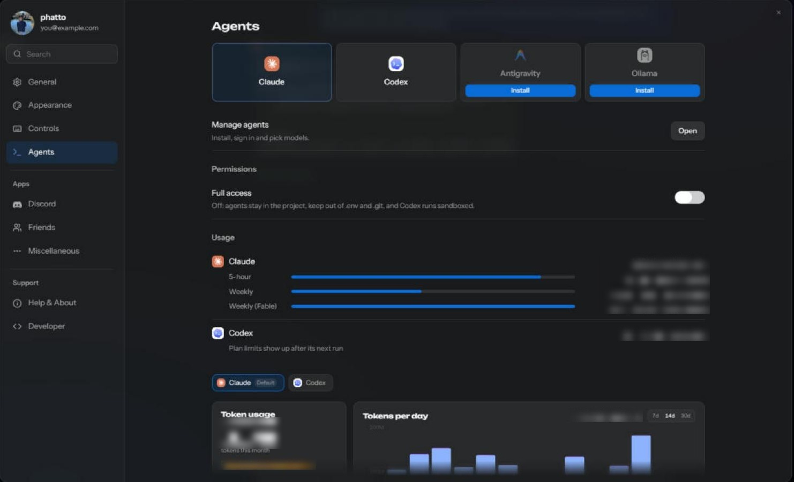</td>
<td width="50%">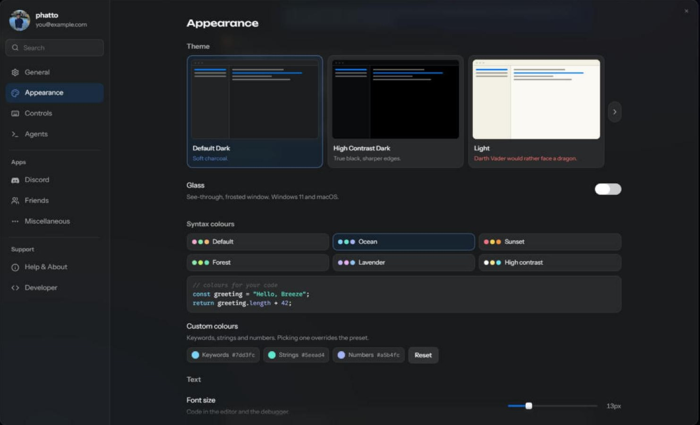</td>
</tr>
<tr>
<td valign="top"><b>Agents.</b> Install and sign in to agents, set the default, turn on full access, and see how much of each plan you've used.</td>
<td valign="top"><b>Appearance.</b> Dark, high contrast and light themes. Glass makes the window see-through, or set your own background picture. Pick a syntax colour preset or your own colours, and the font size.</td>
</tr>
</table>

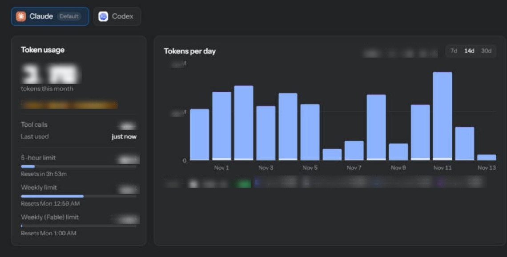

<sub>Home → Agent: 30 days of token use per agent and what it would have cost at API prices (an estimate).</sub>

## Everything else

| | |
| --- | --- |
| **Home** | New file, open folder or clone a repository, your recent projects and your GitHub contributions |
| **First launch** | Looks for coding agents, Git, Node.js and your compilers, and lets you pick a theme and an agent |
| **Friends** | Add friends by email and see who's online and what they're working on. You can hide your project name or stop sharing |
| **Terminal** | A built-in terminal. Pop it out into its own window (with a system info banner) and the same sessions keep running |
| **Skills and MCP** | Browse the skills and plugins your agents load, share skills between agents, and connect MCP servers for Claude Code without editing its config |
| **Workspace sync** | Move workspaces between computers signed in to the same account, stored in a private GitHub repo or Google Drive's hidden app folder |
| **Image attachments** | Drop or paste images into a prompt. Pasted images go to a temp folder, so nothing is added to your project |
| **Local models** | Requests stay small (a project map, ranged file reads and snippet edits) so they fit a small context window |
| **Accounts** | Sign in with GitHub or Google, with more than one account |
| **What's new** | After an update, the first launch shows that release's notes once |
| **Reopens where you left off** | Breeze starts in the view you last used |
| **Discord** | Rich Presence shows what you're working on |
| **Sounds** | Small sounds for clicks, typing and agents, with a volume slider |

## Getting started

You need [Node.js](https://nodejs.org/) 20 or newer. To build the document engine you also need [Rust](https://rustup.rs/).

```bash
npm install
npm run build:engine
npm start
```

`npm start` compiles the TypeScript (main process and renderer) and opens the app. The compiled `.js` files are build output and aren't committed.

> [!TIP]
> Run `npm run build` once, then open `src/renderer/breeze.html` in a browser for a demo of the UI with a sample project and canned agent runs. No Electron needed.

| Script | What it does |
| --- | --- |
| `npm start` | Compile and run the app |
| `npm run build` | Compile TypeScript only |
| `npm run watch` | Compile on change |
| `npm run build:engine` | Build the Rust document engine |
| `npm test` | Compile, syntax-check the main process and run the tests |
| `npm run test:engine` | Run the engine's Rust tests |
| `npm run dist` | Build the Windows installer into `dist/` |

### Configuration

Sign-in and Discord presence need client ids. Copy the example file and fill in your own:

```bash
cp breeze.config.example.json breeze.config.json
```

Or put them in a `.env` file next to `main.js`:

```env
BREEZE_GITHUB_CLIENT_ID=
BREEZE_GOOGLE_CLIENT_ID=
BREEZE_GOOGLE_CLIENT_SECRET=
BREEZE_DISCORD_CLIENT_ID=
```

Environment variables override the config file. Both `breeze.config.json` and `.env` are gitignored; don't commit them.

- **GitHub:** create an OAuth App and enable *Device Flow* (no secret needed).
- **Google:** create a *Desktop app* OAuth client.
- **Discord:** create an application and use its Application ID.

> [!TIP]
> Breeze assumes a local model has a 4k-token context on Ollama and 8k elsewhere. If you raised your server's context size, set `llmContext` in Breeze's saved state so the agent can use the extra room.

### Building the installer

```bash
npm run dist
```

This writes `breeze.config.json` from your `.env` (`scripts/write-config.js`), builds the engine, then builds `dist/Breeze Code Setup <version>.exe` with electron-builder.

> [!WARNING]
> The installer is unsigned, so Windows SmartScreen may warn on other machines. Anything bundled into an installer can be extracted by whoever has it, so only put public client ids (and Google's desktop-app secret, which isn't confidential) in `.env` when building.

## Project layout

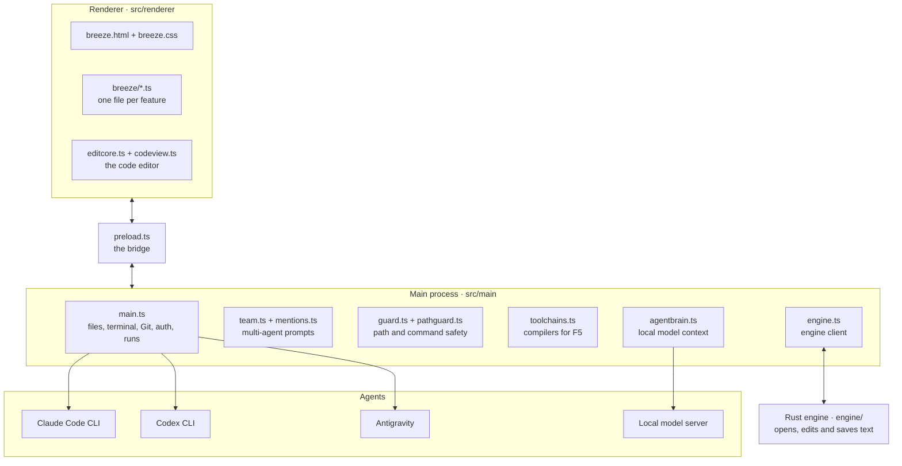

| Path | Purpose |
| --- | --- |
| `src/main/main.ts` | Electron main process: files, terminal, agent runs, usage, Git, auth |
| `src/main/team.ts`, `mentions.ts` | Splitting one prompt between several agents, file claims and crossings |
| `src/main/agentbrain.ts` | The local model's context budget, project map and file-tool formats |
| `src/main/antigravityAgentService.ts` | Talks to Antigravity's agent service |
| `src/main/engine.ts`, `docregistry.ts` | Starts the Rust engine and tracks the documents open in it |
| `src/main/preload.ts` | Bridge between the main process and the UI |
| `src/main/toolchains.ts` | Compiler and tool detection for Run |
| `src/main/lsp.ts` | Language servers |
| `src/main/debug*.ts`, `dap.ts`, `cdp.ts`, `jdwp.ts` | Debugger backends (Python, Node, GDB, .NET, Java) |
| `src/main/kernel.ts` | Python kernels for notebooks |
| `src/main/github.ts`, `prconflict.ts` | Pull requests and conflict resolution in a throwaway worktree |
| `src/main/skills.ts`, `mcp.ts` | Skills, plugins and MCP servers |
| `src/main/sync.ts`, `friends.ts` | Workspace sync and Friends |
| `src/main/previewServer.ts`, `previewInspector.ts` | The live preview and its element inspector |
| `src/main/pricing.ts` | API-price estimates for Home's Agent tab |
| `src/main/discord.ts` | Discord Rich Presence |
| `src/main/guard.ts`, `pathguard.ts` | Path and command safety checks |
| `src/renderer/breeze.html`, `breeze.css` | UI |
| `src/renderer/breeze/` | Renderer logic, one file per feature, loaded in order by `breeze.html` |
| `src/renderer/editcore.ts`, `codeview.ts` | The editor's position logic and its virtualized text surface |
| `engine/` | The Rust document engine (opening, editing, undo journal, search, saving) |
| `assets/brand/` · `fonts/` · `icons/` | App icon and wordmarks · bundled fonts · agent and feed logos |
| `runtime/` | C runtime helpers |
| `scripts/` | Build helpers |
| `docs/screenshots/` | Screenshots used in this README |
| `test/` | Tests |

## Team

| Member | Role |
| --- | --- |
| [@itsphatto](https://github.com/itsphatto) | Founder and Lead Software Engineer |
| [@sapfire151](https://github.com/sapfire151) | Co-Founder, Lead Frontend Developer and UI/UX Designer |
| [@LangZab](https://github.com/LangZab) | Contributor, Emotional Support |
| [@esrazti](https://github.com/esrazti) | The Origin |

## License

Breeze Code is free, source-available software under the [Breeze Code Source-Available License](LICENSE). You can read the source and use Breeze Code for anything, including commercial work. You can't copy its code into other projects or redistribute it, changed or not. Versions published before November 7, 2026 stay under the MIT License.
