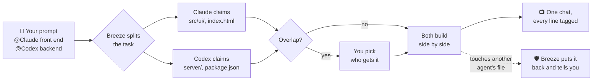
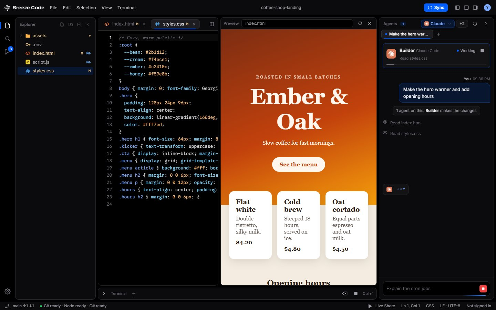
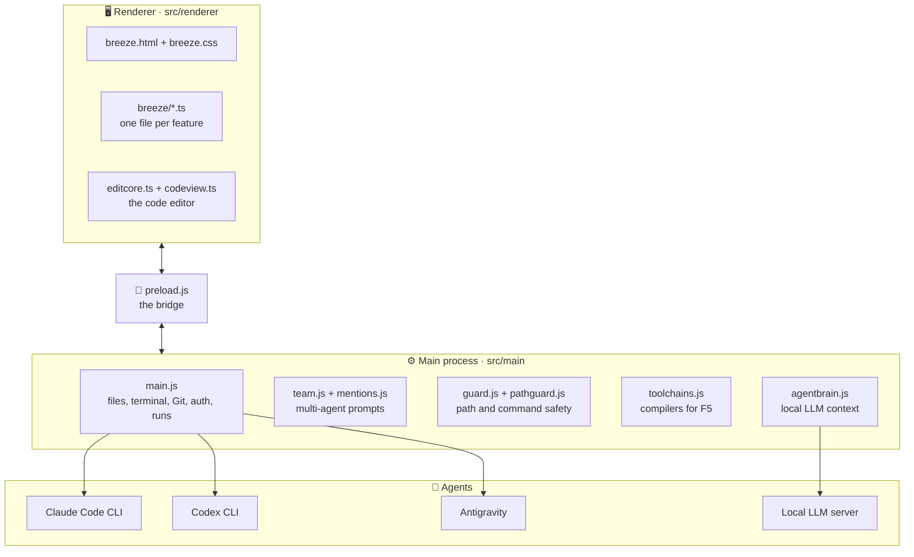

<div align="center">


<br>


<br>

### Code at blazing speed. Turn ideas into reality.

A free, featherweight code editor for Windows. Say what you want in plain words,<br>
then watch Claude Code, Codex, Antigravity or a local model build it, live, right next to your code.

<br>

[**⬇ Download for Windows**](https://github.com/itsphatto/BreezeCode/releases/latest) &nbsp;·&nbsp; [Website](https://breezecode.itsphatto.site) &nbsp;·&nbsp; [FAQ](https://breezecode.itsphatto.site/FAQ.html) &nbsp;·&nbsp; [Report a bug](https://github.com/itsphatto/BreezeCode/issues)

<br>


<br>


<sub>[Why](#why-breeze-code) · [Agents](#bring-your-own-agent) · [Multi-agent](#several-agents-one-prompt) · [Features](#features) · [Getting started](#getting-started) · [Configuration](#configuration) · [Installer](#building-the-installer) · [How it fits together](#how-it-fits-together)</sub>

<br>


</div>

<br>

## Why Breeze Code

<table>
<tr>
<td width="50%" valign="top">

**👀 Watch every move**<br>
Every file read, edit and command an agent makes streams into the chat as it happens, tagged with who did it. No black box.

</td>
<td width="50%" valign="top">

**🤝 Bring the agent you already use**<br>
Claude Code, Codex, Antigravity, or a local model through Ollama, LM Studio or any OpenAI-compatible server. Swap any time.

</td>
</tr>
<tr>
<td width="50%" valign="top">

**🪶 Light and free**<br>
No plans and no credits. You only pay if you pick a paid agent. A local model runs with zero cloud.

</td>
<td width="50%" valign="top">

**🔒 Yours stays yours**<br>
Files stay on your PC, API keys and sign-in tokens are encrypted by the Windows keychain, and updates ask before downloading.

</td>
</tr>
</table>

## Bring your own agent

Breeze finds the coding agents already installed on your computer and signs in with their own accounts. Pick a default, then set its model and effort from its chip in the agents panel.

| Agent | How Breeze talks to it | Plan usage in Settings |
| --- | --- | --- |
|  **Claude Code** | The `claude` CLI | Tokens this month, plus live 5-hour and weekly limits |
|  **Codex** | The `codex` CLI | Tokens this month, plus its plan window |
|  **Antigravity** | Antigravity's agent service | Not reported by Antigravity |
|  **Local model** | Ollama, LM Studio or any OpenAI-compatible server | No limit, it runs on your PC |

## Several agents, one prompt

@mention agents from different companies in a single prompt and each takes its piece. They call dibs on their files first, you settle any overlap, and then they build side by side.



## Features

<table>
<tr>
<td width="50%" valign="top">

### Watch it work

Ask in plain words. The agent card shows who's on it and what they're up to, and every read, edit and command lands in the chat live.

</td>
<td width="50%"></td>
</tr>
<tr>
<td width="50%"></td>
<td width="50%" valign="top">

### Your agent, found

First launch looks for coding agents, Git and Node.js. Pick one, or point Breeze at a local model. Settings → Agents shows each agent's usage and rescans on its own when you install something new.

</td>
</tr>
<tr>
<td width="50%" valign="top">

### Save points, thanks to Git

Stage, discard, commit and push from Source Control, with a graph of every checkpoint and branch. Files an agent is touching get flagged in the explorer and tabs.

</td>
<td width="50%"></td>
</tr>
<tr>
<td width="50%"></td>
<td width="50%" valign="top">

### Breeze Box

Just a prompt and a chat. No editor, no fuss. Code in a reply turns into a card you can copy or download in one click.

</td>
</tr>
<tr>
<td width="50%" valign="top">

### Vibe Code Mode

While an agent works, the IDE fades out and an Instagram or Facebook feed rolls. A card says when your code's ready; head back whenever you like.

</td>
<td width="50%"></td>
</tr>
</table>

### Oh, and

| | |
| --- | --- |
| ▶️ **Run with F5** | Python, C, C++, C#, Java and Rust run on the compilers you already have. Missing one? Breeze tells you what to grab |
| 🌐 **Live preview** | Pop `index.html` open beside your code and refresh as you go |
| 💻 **Built-in terminal** | Run Node and whatever else without leaving the editor |
| 📄 **Big files, no sweat** | Only the lines on screen get drawn, so huge files stay snappy |
| 🧠 **Local LLM, token-wise** | A project map, ranged file reads and snippet edits keep requests small |
| 👥 **Accounts** | Sign in with GitHub or Google, with several accounts |
| 🎮 **Discord** | Rich Presence shows what you're working on |
| 🔊 **Feels alive** | Tiny synthesized sounds for clicks, typing and agents, with a volume slider |

## Getting started

Requires [Node.js](https://nodejs.org/) 20 or newer.

```bash
npm install
npm start
```

`npm start` compiles the renderer's TypeScript (`src/renderer/breeze/*.ts`, `editcore.ts`, `codeview.ts`) and launches the app. The compiled `.js` files are build output and aren't committed.

> [!TIP]
> Run `npm run build` once, then open `src/renderer/breeze.html` in a browser for a demo of the UI with a sample project and canned agent runs. No Electron needed.

| Script | What it does |
| --- | --- |
| `npm start` | Compile and run the app |
| `npm run build` | Compile TypeScript only |
| `npm run watch` | Compile on change |
| `npm test` | Syntax-check the main process and run the tests |
| `npm run dist` | Build the Windows installer into `dist/` |

## Configuration

Sign-in and Discord presence need client ids. Copy the example file and fill in your own:

```bash
cp breeze.config.example.json breeze.config.json
```

Or put them in a `.env` file next to `main.js`:

```env
BREEZE_GITHUB_CLIENT_ID=
BREEZE_GOOGLE_CLIENT_ID=
BREEZE_GOOGLE_CLIENT_SECRET=
BREEZE_DISCORD_CLIENT_ID=
```

Environment variables override the config file. Both `breeze.config.json` and `.env` are gitignored; never commit them.

- **GitHub:** create an OAuth App and enable *Device Flow* (no secret needed).
- **Google:** create a *Desktop app* OAuth client.
- **Discord:** create an application and use its Application ID.

> [!TIP]
> Breeze assumes a local LLM has a 4k-token context on Ollama and 8k elsewhere. If you raised your server's context size, set `llmContext` in Breeze's saved state so the agent can use the extra room.

## Building the installer

```bash
npm run dist
```

This runs `scripts/write-config.js`, which writes `breeze.config.json` from your `.env` so the packaged app has its client ids, then builds `dist/Breeze Code Setup <version>.exe` with electron-builder.

> [!WARNING]
> The installer is unsigned, so Windows SmartScreen may warn on other machines. Values bundled into an installer can be extracted by anyone who has it, so only put public client ids (and Google's desktop-app secret, which is not confidential) in `.env` when building.

## How it fits together



| Path | Purpose |
| --- | --- |
| `src/main/main.js` | Electron main process: files, terminal, agent runs, usage, Git, auth |
| `src/main/team.js`, `mentions.js` | Splitting one prompt between several agents, file claims and crossings |
| `src/main/agentbrain.js` | The local LLM agent's context budget, project map and file-tool formats |
| `src/main/antigravityAgentService.ts` | Talks to Antigravity's agent service |
| `src/main/preload.js` | Bridge between the main process and the UI |
| `src/main/toolchains.js` | Compiler and tool detection for Run |
| `src/main/discord.js` | Discord Rich Presence client |
| `src/main/guard.js`, `pathguard.js` | Path and command safety checks |
| `src/renderer/breeze.html`, `breeze.css` | UI |
| `src/renderer/breeze/` | Renderer logic, one file per feature (settings, git, terminal and so on), loaded in order by `breeze.html` |
| `src/renderer/editcore.ts`, `codeview.ts` | The code editor's position logic and its virtualized text surface |
| `assets/brand/` · `fonts/` · `icons/` | App icon and wordmarks · bundled fonts · agent and feed logos |
| `runtime/` | C runtime helpers |
| `scripts/` | Build helpers |
| `docs/screenshots/` | Screenshots used in this README |
| `BreezeCode-Web/` | The website |
| `test/` | Tests |

<br>

<div align="center">
<sub>Free and open source · MIT licensed</sub>
</div>
